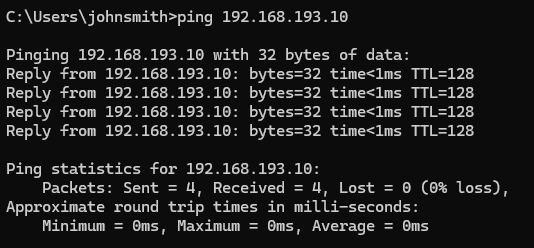
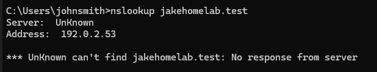
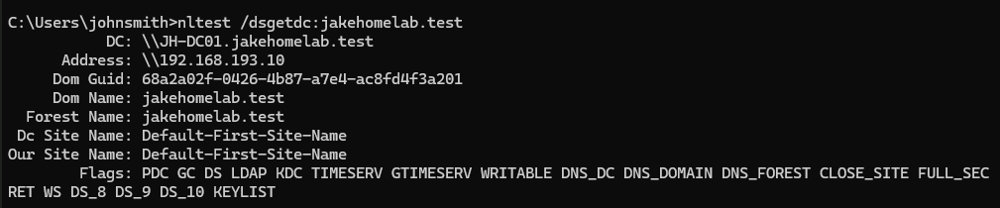

<h1>DNS Misconfiguration Command Line Tools</h1>

 ping 192.168.193.10 — Tests connectivity between the workstation and the domain controller by IP address. All four packets were received successfully.

 

nslookup jakehomelab.test — Tests DNS resolution for the Active Directory domain. Failed because the configured DNS server (192.0.2.53) did not respond.

 

nslookup -type=SRV _ldap._tcp.dc._msdcs.jakehomelab.test — Checks DNS for the LDAP service-location records used to locate Active Directory domain controllers. Failed due to the DNS server not responding.

 

nltest /dsgetdc:jakehomelab.test — Locates a domain controller for the specified domain. Successfully discovered JH-DC01 at 192.168.193.10, despite the failed DNS queries.

 
